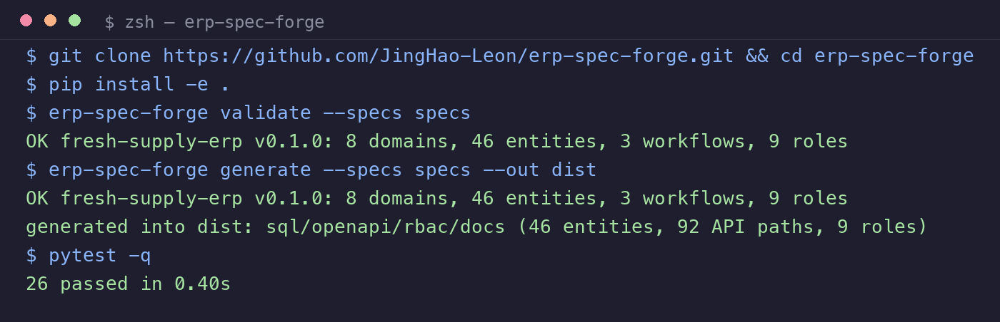

<div align="center">

# erp-spec-forge

**用 YAML 规格描述一套 ERP，一键锻造出 SQL、OpenAPI、权限矩阵与领域文档**

[](https://github.com/JingHao-Leon/erp-spec-forge/actions/workflows/ci.yml)
[](LICENSE)
[](pyproject.toml)
[](docs/spec-grammar.md)
[](#本地验证)

</div>

**erp-spec-forge 是一个 spec-driven design（规格驱动设计）工具库**：把 ERP 系统的模块、实体、字段、权限、单据状态机写成 YAML 规格，然后用一条命令生成 MySQL 建表脚本、OpenAPI 3.1 接口契约、RBAC 权限矩阵、模块注册表和数据字典。适合需要在多个项目间**模板化复用 ERP 领域模型**的后端团队与低代码平台开发者。



## 为什么是规格驱动

ERP 项目 80% 的第一周都在做同样的事：建商品/客户/订单表、写 CRUD、配权限矩阵。这些"领域骨架"高度同构，却每次都被手写一遍——写完的表结构和权限口径还常常和文档对不上。

erp-spec-forge 把骨架变成**单一事实源（spec）**：

- 规格即文档：`specs/` 下的 YAML 就是领域模型，评审/入库/生成走同一份文件
- 生成即一致：SQL、OpenAPI、权限矩阵全部从同一规格派生，永不漂移
- 校验即门禁：FK 指向、枚举默认值、状态机可达性、角色授权引用，`validate` 一条命令全查

## 快速上手

```bash
git clone https://github.com/JingHao-Leon/erp-spec-forge.git
cd erp-spec-forge
pip install -e .            # 依赖仅 PyYAML

# 1) 校验规格树
erp-spec-forge validate --specs specs
# OK fresh-supply-erp v0.1.0: 8 domains, 46 entities, 3 workflows, 9 roles

# 2) 生成全套产物
erp-spec-forge generate --specs specs --out dist
# generated into dist: sql/openapi/rbac/docs (46 entities, 92 API paths, 9 roles)
```

生成示例（`examples/` 目录为当前规格的真实产物，可直接查看）：

| 产物 | 内容 | 规模 |
|---|---|---|
| `sql/schema.sql` | MySQL 8 建表脚本（PK/FK/CHECK 枚举约束/注释） | 46 表，575 行 |
| `openapi/openapi.yaml` | OpenAPI 3.1，每实体 5 个 CRUD 端点 + 统一响应包络 | 92 路径 / 230 操作 |
| `rbac/matrix.md` `.csv` | 功能码 × 角色授权矩阵 | 242 功能码 × 9 角色 |
| `rbac/registry.json` | 模块注册表（模块→功能码清单），可直接喂给权限中间件 | 8 模块 |
| `docs/data-dictionary.md` | 数据字典（字段/类型/必填/默认值/说明） | 551 行 |
| `docs/workflows.md` | 单据状态机（mermaid + 事件表） | 3 个工作流 |

## 规格长什么样

**实体与字段**（`specs/domains/procurement.yaml`）：

```yaml
domain: procurement
name: 采购管理
entities:
  - name: purchase_task
    display: 采购任务
    fields:
      - {name: id, type: pk}
      - {name: task_no, type: string, required: true, length: 32}
      - {name: delivery_date, type: date, required: true}
      - {name: task_type, type: enum, values: [fresh, dry], default: fresh}
      - {name: status, type: enum, values: [draft, released, executing, completed, cancelled]}
      - {name: remark, type: string, length: 255}
```

**单据状态机**（`specs/workflows/purchase_task.yaml`，生成 mermaid 图）：

```yaml
workflow: purchase_task_lifecycle
entity: purchase_task
initial: draft
states:
  - {name: draft, display: 草稿}
  - {name: released, display: 已发布}
  - {name: completed, display: 已完成, final: true}
transitions:
  - {from: draft, to: released, event: release, role: purchase_clerk}
```

**角色授权**（`specs/rbac.yaml`）：实体 CRUD 功能码（`purchase_task_list` 等 5 个动词）由生成器自动推导，角色只需声明 `模块: "*"` 或显式功能码清单。完整语法见 [docs/spec-grammar.md](docs/spec-grammar.md)。

## 内置示例领域（46 实体）

基础主数据（商品/SKU/分类/单位/税率/区域）· 采购（供应商/报价/比价/任务/比例分配）· 销售（客户/订单）· 库存（出入库/盘点/调整）· 配送（路线/承运商/司机/GPS 设备与报警）· 结算（对账/收款/应付）· 溯源（批次/检测报告/公开页）· 系统管理（用户/角色/参数/日志）

领域模型提炼自真实生鲜供应链 ERP 的通用形态，全部为原创泛化设计，不含任何特定系统的私有数据。

## 它如何被使用

```text
specs/*.yaml ──► erp-spec-forge validate ──► 门禁通过
                    │
                    └─► erp-spec-forge generate ──► sql/  openapi/  rbac/  docs/
                                                        │
                                                        ▼
                                    喂给你的脚手架/后端框架/权限中间件
```

典型场景：新项目立项时复制 `specs/` 改出领域规格 → 生成表结构与接口契约 → 交给后端实现或代码生成器；已有项目用它**反向梳理**领域模型并生成文档基线。

## 本地验证

```bash
pip install -e ".[dev]"
pytest -q
# 26 passed in 0.42s（Python 3.13；断言见 tests/：46 实体、92 路径、230 操作、242 功能码等）
```

## Limitations / 局限

- 当前 DDL 目标方言为 **MySQL 8**（InnoDB/utf8mb4），PostgreSQL/SQLite 方言未实现
- OpenAPI 只生成 CRUD 与统一响应包络，鉴权/限流/分页风格需按团队规范二次加工
- 状态机目前是**规格与文档**层，不做运行时引擎（不拦截非法状态迁移）
- 权限矩阵只到"功能码"粒度，行级数据权限（如"只看自己客户"）不在规格内
- 不做多租户/多语言建模——需要时在规格中自行扩展字段

## Contributing

欢迎 PR：新增领域方言、更多生成目标（Prisma/Drizzle schema、Django models）、规格校验规则。见 [CONTRIBUTING.md](CONTRIBUTING.md)；对 spec-driven 生态的致敬与贡献路线见 [docs/related-projects.md](docs/related-projects.md)。

## License

[MIT](LICENSE)
