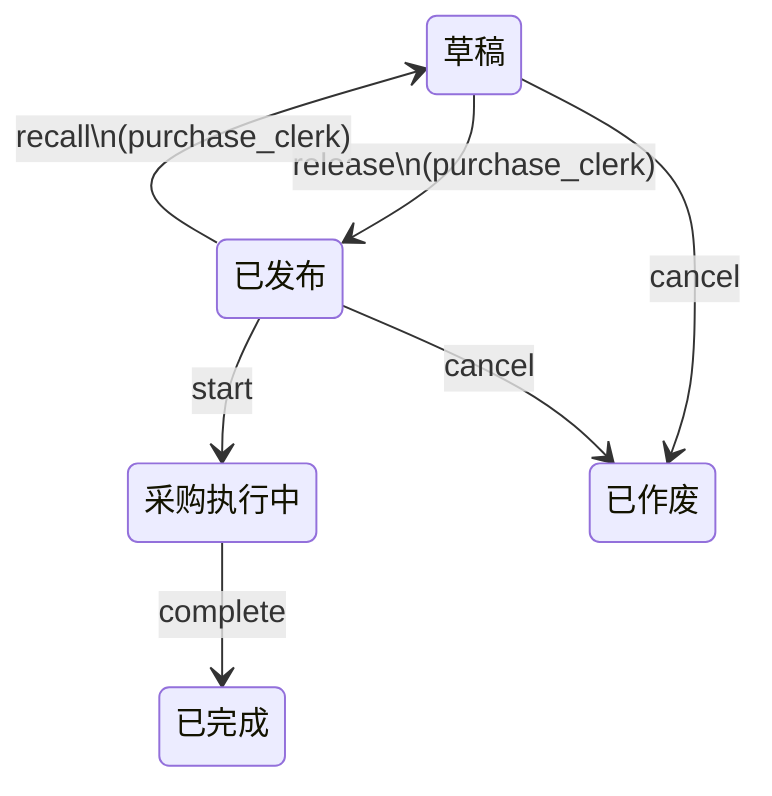
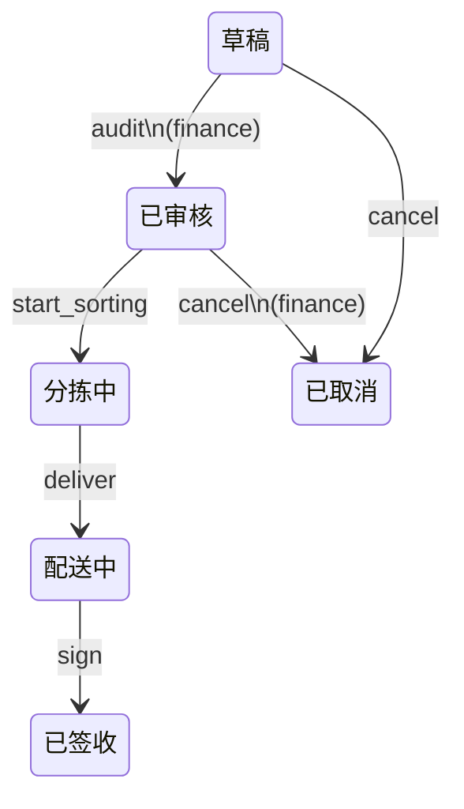
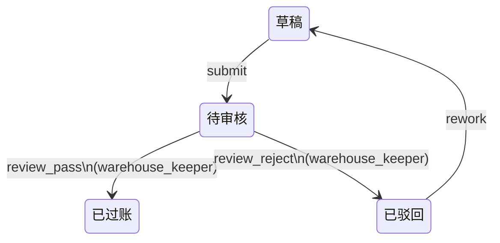

# 单据状态机（Workflow）

> 由 erp-spec-forge 生成，mermaid 可直接渲染。

## 采购任务生命周期（purchase_task_lifecycle）— 实体 `purchase_task`

| 事件 | 从 | 到 | 角色 |
|---|---|---|---|
| release | draft | released | purchase_clerk |
| recall | released | draft | purchase_clerk |
| start | released | executing | — |
| complete | executing | completed | — |
| cancel | draft | cancelled | — |
| cancel | released | cancelled | — |

## 销售订单生命周期（sales_order_lifecycle）— 实体 `sales_order`

| 事件 | 从 | 到 | 角色 |
|---|---|---|---|
| audit | draft | confirmed | finance |
| start_sorting | confirmed | sorting | — |
| deliver | sorting | delivering | — |
| sign | delivering | signed | — |
| cancel | draft | cancelled | — |
| cancel | confirmed | cancelled | finance |

## 入库单审核流（stock_in_review）— 实体 `stock_in`

| 事件 | 从 | 到 | 角色 |
|---|---|---|---|
| submit | draft | pending_review | — |
| review_pass | pending_review | posted | warehouse_keeper |
| review_reject | pending_review | rejected | warehouse_keeper |
| rework | rejected | draft | — |
